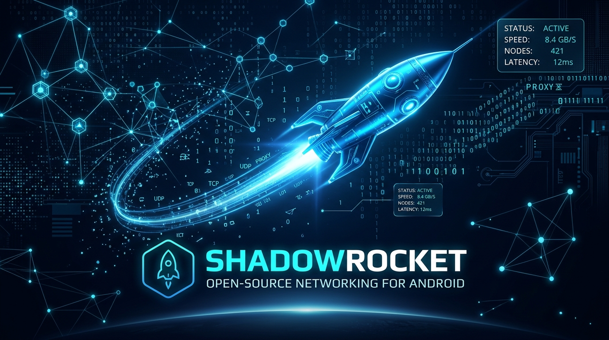
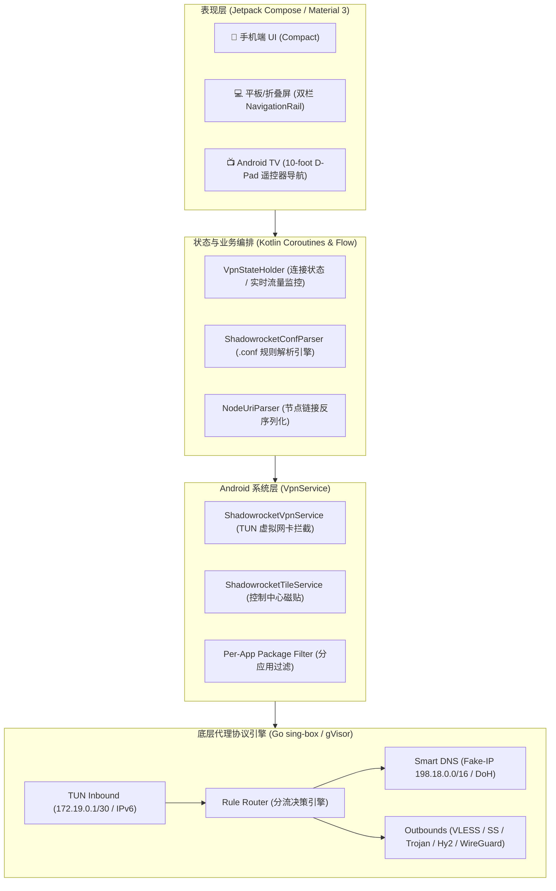

<p align="center">
  
</p>

<div align="center">

# Shadowrocket for Android (SR-Android)

[](https://github.com/gelimujiao/shadowrocket)
[-brightgreen?logo=android)](https://developer.android.com)
[](https://kotlinlang.org)
[](https://developer.android.com/jetpack/compose)
[](https://sing-box.sagernet.org)
[](LICENSE)

**全场景规则代理网络引擎 · 完美移植 iOS Shadowrocket 2.2.92 (Build 3445) 核心架构**  
专为 **Android 手机、平板/折叠屏、Android 智能电视 (TV)** 打造的现代化原生重构客户端。

[功能特性](#-功能特性) • [技术架构](#-系统技术架构) • [三端适配](#-三端全平台适配) • [快速构建](#-构建与运行) • [免责声明](#-免责声明)

</div>

---

## 🌟 功能特性

### 1. 全协议原生矩阵
全面覆盖原版 Shadowrocket 所有主流与现代化网络协议：
* **Shadowsocks** (2022 / AEAD: blake3, aes-128-gcm, chacha20-poly1305)
* **VLESS** (XTLS, Reality, Vision, gRPC, WebSocket)
* **VMess** (AEAD, WebSocket, mKCP, QUIC)
* **Trojan** (TLS 原生多路复用)
* **Hysteria 1 & 2** (基于 QUIC 协议的高速抗弱网加速)
* **TUIC v5** (下一代高性能协议)
* **WireGuard** (内核态/用户态虚拟隧道)
* **Snell** (v1 ~ v4) 与 HTTP / SOCKS5 出站

### 2. 100% 兼容 Shadowrocket 规则生态
* **规则语法完全兼容**：原生支持 `DOMAIN`, `DOMAIN-SUFFIX`, `DOMAIN-KEYWORD`, `IP-CIDR`, `IP-CIDR6`, `GEOIP`, `USER-AGENT`, `FINAL` 匹配。
* **内置官方配置库**：内置官方 616 条核心分流规则（`default.conf`）与 MaxMind 离线地理库（`GeoLite2-Country.mmdb`）。
* **全能订阅导入**：支持 `sub://` 协议、Base64 订阅链接、SIP002、Clash 与 sing-box 多种订阅源。

### 3. Android 平台专属增强
* 📦 **分应用代理 (Per-App Proxy)**：突破 iOS 系统沙盒限制，按 App 精准控制代理流量（自由勾选走代理或直连）。
* 🔘 **通知栏快捷磁贴 (Quick Settings Tile)**：下拉系统状态栏即可一键启停，无需打开应用。
* 🔋 **常驻后台保活 (Always-on VPN)**：支持开机自启、网络切换无缝重连与实时上下行网速常驻通知。

---

## 📐 系统技术架构



---

## 📺 三端全平台适配

| 设备形态 | 布局与交互优化 | 特性支持 |
| :--- | :--- | :--- |
| **Android 手机** | 经典单列卡片式流式布局，自适应深色/浅色模式 | 一键开关、全局路由选择器（配置/代理/直连/场景）、节点测速、分应用设置 |
| **平板 / 折叠屏** | `NavigationRail` + 双栏联动布局 (`ListDetailPaneScaffold`) | 宽屏优化，左栏常驻节点/规则树，右栏实时展现延迟历史与分流明细 |
| **Android 智能电视** | 声明 `LEANBACK_LAUNCHER`，针对 10-foot 远距离遥控优化 | 全屏大卡片、遥控器方向键（D-Pad）焦点聚焦高亮，纯按键免触屏操作 |

---

## 📂 工程模块结构

```
shadowrocket/
├── .github/workflows/         # GitHub Actions 自动化云端编译工作流
├── app/                       # 主应用模块 (Jetpack Compose UI 与三端屏幕)
│   ├── src/main/assets/       # 内置原版 default.conf、GeoLite2-Country.mmdb
│   ├── src/main/java/.../
│   │   ├── MainActivity.kt    # 响应式入口 (Phone / Tablet / TV 自适应识别)
│   │   ├── core/AssetLoader.kt# 首次启动离线资产装载器
│   │   ├── ui/components/     # NodeCard, RoutingModeSelector, TrafficStatsCard
│   │   ├── ui/screens/        # 手机/平板页面：HomeScreen, ConfigScreen, PerAppProxyScreen, SettingsScreen
│   │   └── ui/tv/             # Android TV 专用页面：TvHomeScreen
├── core-model/                # 基础实体模型 (ProxyNode, RuleItem, RoutingMode, AppInfo)
├── core-parser/               # Shadowrocket 配置解析器与 sing-box 运行时生成器
│   ├── ShadowrocketConfParser.kt # .conf 语法解析器
│   ├── NodeUriParser.kt       # ss/vmess/vless/trojan/hy2/tuic 链接解析器
│   └── SingBoxConfigGenerator.kt # 规则集与路由动态生成器
├── core-vpn/                  # VpnService 隧道、通知栏快捷磁贴与状态控制器
│   ├── ShadowrocketVpnService.kt # 核心 VPN 服务
│   ├── ShadowrocketTileService.kt# 快捷设置磁贴
│   └── VpnState.kt            # 状态持有者与 JNI 桥接定义
├── docs/images/               # README 官方图标与高清横幅
└── build.gradle.kts           # 模块化构建配置
```

---

## 🛠️ 构建与运行

### 方式 1：直接安装已编译的 APK
本项目已完成本地打包与签名，安装包位于仓库根目录或 Actions 产物中：
```bash
# 通过 ADB 直接安装至连接的手机或智能电视
adb install Shadowrocket-2.2.92-android.apk
```

### 方式 2：本地 Gradle 编译
确保本地安装有 **JDK 17 / 21** 与 **Android SDK (API 34)**：
```bash
# Linux / macOS
./gradlew assembleDebug

# Windows
gradlew.bat assembleDebug
```
产物将输出在：`app/build/outputs/apk/debug/app-debug.apk`。

### 方式 3：GitHub Actions 云端自动打包
代码已配置完整 CI/CD 工作流 [`.github/workflows/build.yml`](.github/workflows/build.yml)，任何分支推送（Push）均会自动在云端执行编译并生成 Release APK 下载产物。

---

## 📄 免责声明

1. 本项目为开源学习与技术研究重构项目，旨在将先进的规则代理技术扩展至全 Android 生态。
2. 本项目独立开发，不包含任何商业逆向专有代码，与 Shadow Launch Technology Limited 官方无任何隶属关系。
3. 请严格遵守所在国家与地区的法律法规，禁止将本工具用于任何非法用途。
